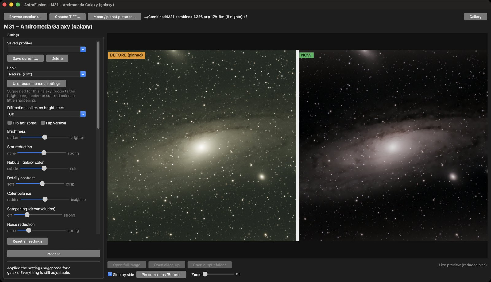
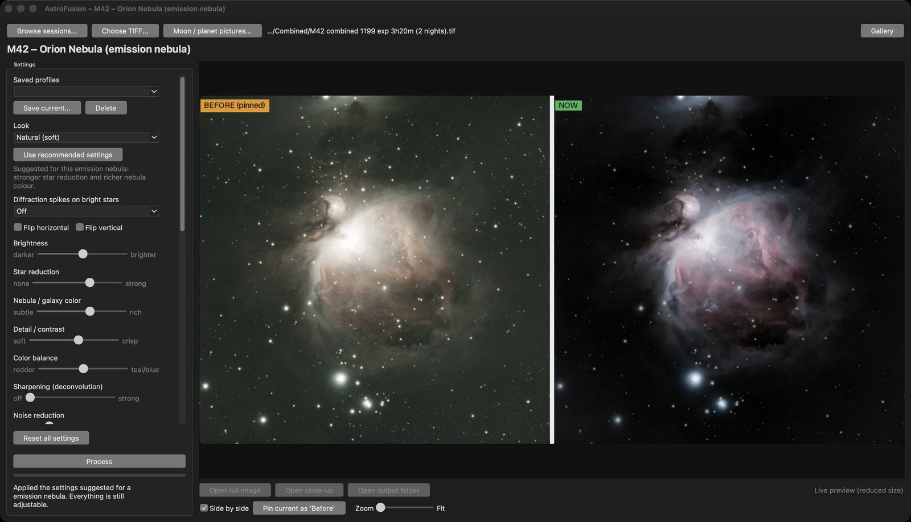
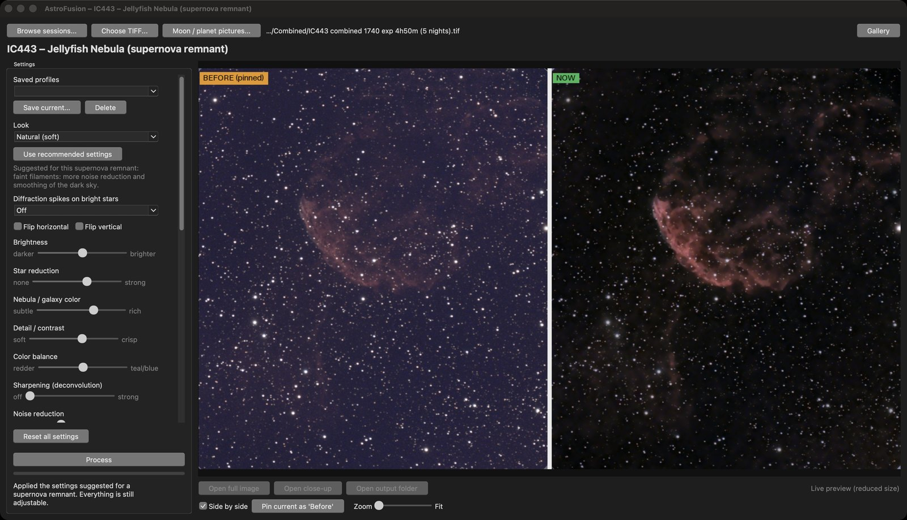
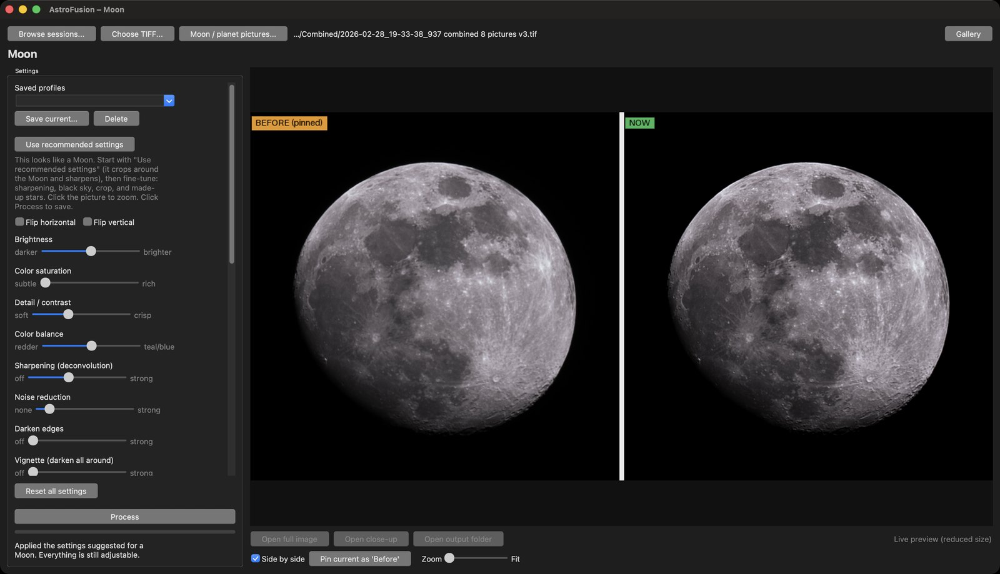
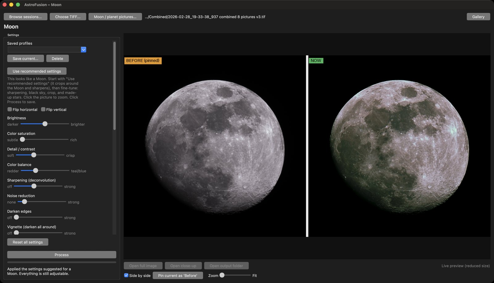
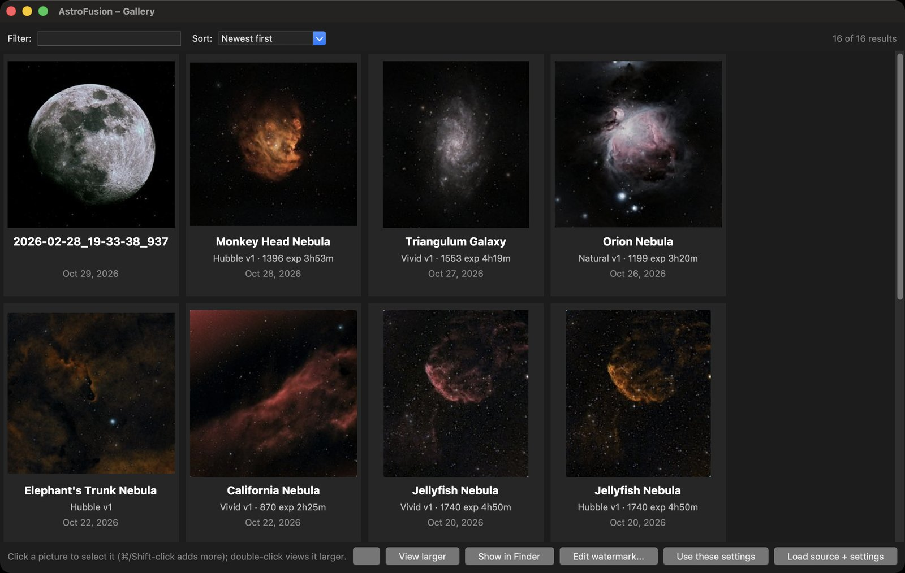

# AstroFusion downloads

Ready-to-run **AstroFusion** apps for stacked TIFFs and Moon / planet pictures from a Vaonis Vespera / Vespera Pro: live
preview, star reduction and removal, curves, crop, watermark with capture details, recommended settings by object type.
For the Moon and planets, line up and combine many pictures into one cleaner picture, bring out the Moon's mineral color,
and add optional made-up stars (marked as artificial in the saved file). No Python needed.

**Download:** open the [latest release](../../releases/latest) and get the zip for your computer
(`AstroFusion-Mac-AppleSilicon.zip` or `AstroFusion-Windows.zip`). Once installed, the app can check for and install
updates itself (Help → Check for Updates).

## Screenshots
Before on the left, now on the right, while you move the sliders. All of these are real Vespera data.

**Galaxy: Andromeda (M31)**, eight nights combined

**Emission nebula: Orion (M42)**

**Supernova remnant: Jellyfish Nebula (IC443)**, five nights combined

**The Moon, as captured and sharpened** (eight pictures lined up and combined, cropped around the Moon)

**The Moon with the "Mineral Moon Dark (stars)" look** (brings out the faint color differences in the surface, deepens the sky and adds made-up stars; the Look list for Moon pictures also has "Mineral Moon" without stars and "Crisp Moon" with no color boost). The watermark at the bottom shows the details read from the pictures: *Live view*, the camera and when it was taken.

**Gallery**: every result, with the settings that made it

## First launch
The apps are not signed with a paid developer certificate, so the first launch needs one extra step.

- **Mac:** double-click the app, click **Done** on the warning, then open **System Settings → Privacy & Security**, scroll to
  the Security section and click **Open Anyway** next to "AstroFusion was blocked". Or run this once in Terminal (adjust the path):
  `xattr -dr com.apple.quarantine ~/Downloads/AstroFusion.app`
- **Windows:** open the `AstroFusion` folder and run `AstroFusion.exe`. If SmartScreen warns, choose **More info**, then **Run anyway**.

## Version history
Newest first. Each release has its full notes on the [releases page](../../releases).

- **1.3.5**: A setting's name turns orange with a dot (●) when you've moved it away from its starting value, so changes are easy to
  spot in every version of the app.
- **1.3.4**: AstroFusion asks "Abandon changes?" when you quit (or install an update) with changes that haven't been processed and saved.
- **1.3.3**: A clearer list when combining nights: one row per night (earlier snapshots of a night's stack are hidden), nights that
  overlap can't be picked together, *Select all of this target* picks the deepest stack of each night, and a line under the list
  says what your selection will do. Combined files remember which nights went into them. Removed the "Close-up crop of target"
  setting (the Crop control does that job). The settings panel scrolls properly when Fine-tune opens, and scrolling over a
  drop-down no longer changes its choice.
- **1.3.2**: Right-click the picture to copy the finished image (or the Before) to the clipboard, and right-click a result in the
  Gallery to copy it, open it or show it in its folder. Added this version history.
- **1.3.1**: Fixed a green tint on the Moon. New Look list for Moon pictures: Mineral Moon, Mineral Moon Dark (stars) and
  Crisp Moon. Live view pictures are labeled "Live view" and their capture time is read from the file name. Moon results are
  named "Moon <date>", and a target name typed in the watermark's Object field names the saved file and the Gallery title.
  Clearer combine summary. American spelling.
- **1.3.0**: Moon and planet pictures: open a JPG / PNG, or combine many into one cleaner picture. Mineral color, Black sky
  and optional made-up stars. Crop for every picture, working zoom on Moon pictures, and pictures fill the window.
- **1.2.1**: Updated build tooling.
- **1.2.0**: *Check for Updates* with in-app install on the Mac, and this downloads page.
- **1.1.2**: Recommended settings by object type.
- **1.1.1**: Place lookup and light-pollution map buttons in the watermark dialog.
- **1.1.0**: Tone curve, starless mode, watermark, About window, and native Mac and Windows apps.
- **1.0.0**: First release.

Independent of Vaonis and not affiliated with them. Released under the MIT license (see `LICENSE`).
