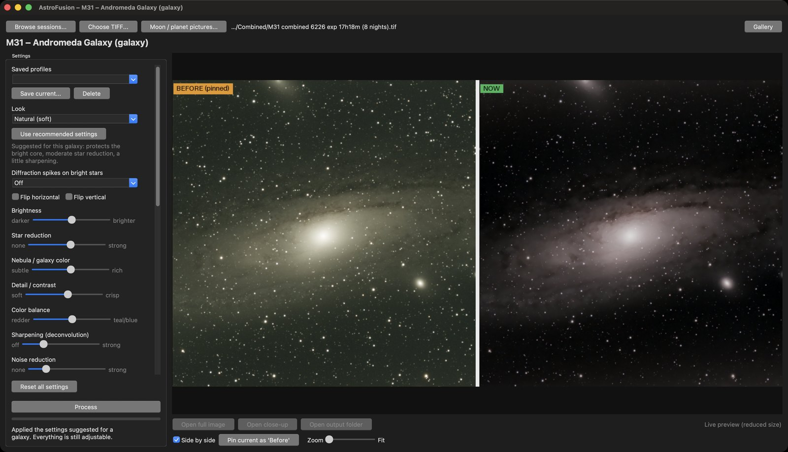
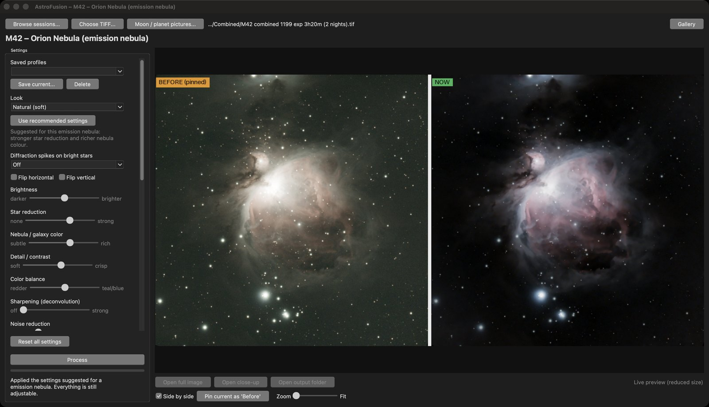
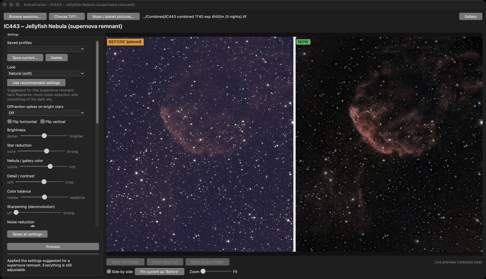
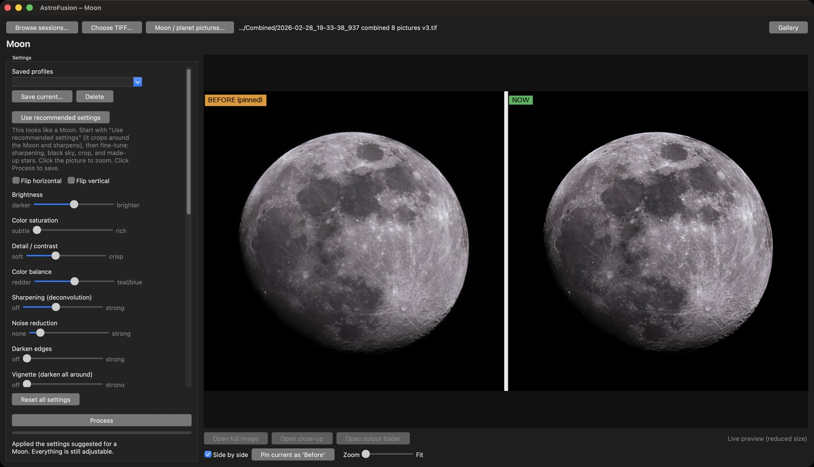
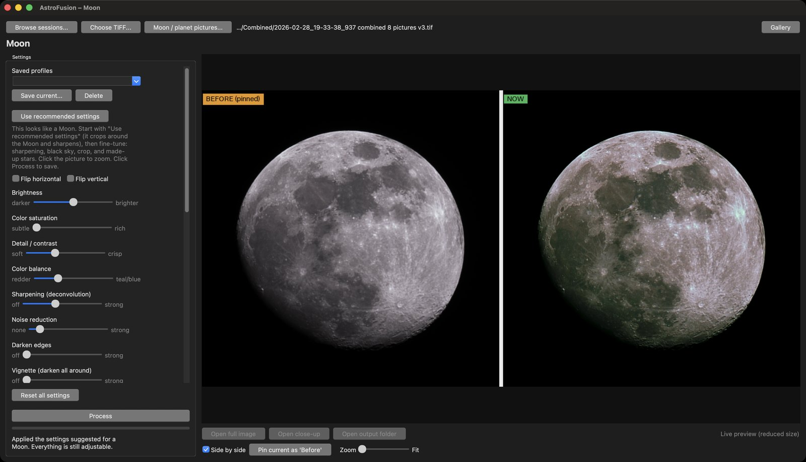
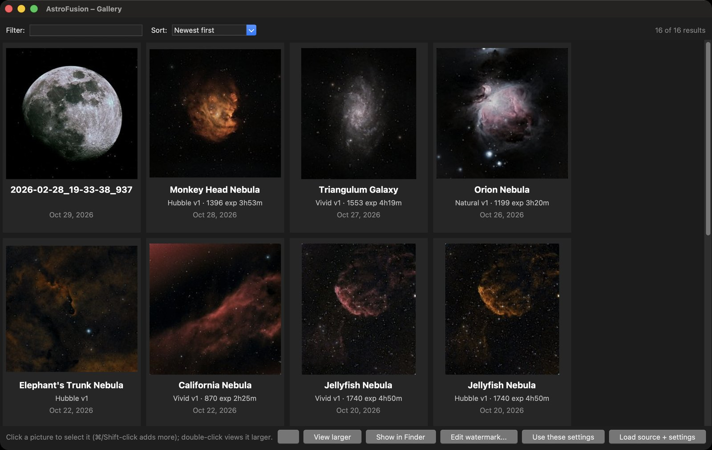

# AstroFusion downloads

Ready-to-run **AstroFusion** apps for stacked TIFFs and Moon / planet pictures from a Vaonis Vespera / Vespera Pro: live
preview, star reduction and removal, curves, crop, watermark with capture details, recommended settings by object type.
For the Moon and planets, line up and combine many pictures into one cleaner picture, bring out the Moon's mineral color,
and add optional made-up stars (marked as artificial in the saved file). No Python needed.

**Download:** open the [latest release](../../releases/latest) and get the zip for your computer
(`AstroFusion-Mac-AppleSilicon.zip` or `AstroFusion-Windows.zip`). Once installed, the app can check for and install
updates itself (Help → Check for Updates).

## Screenshots
Before on the left, now on the right, while you move the sliders. All of these are real Vespera data.

**Galaxy: Andromeda (M31)**, eight nights combined

**Emission nebula: Orion (M42)**

**Supernova remnant: Jellyfish Nebula (IC443)**, five nights combined

**The Moon, as captured and sharpened** (eight pictures lined up and combined, cropped around the Moon)

**The Moon with the "Mineral Moon Dark (stars)" look** (brings out the faint color differences in the surface, deepens the sky and adds made-up stars; the Look list for Moon pictures also has "Mineral Moon" without stars and "Crisp Moon" with no color boost). The watermark at the bottom shows the details read from the pictures: *Live view*, the camera and when it was taken.

**Gallery**: every result, with the settings that made it

## First launch
The apps are not signed with a paid developer certificate, so the first launch needs one extra step.

- **Mac:** double-click the app, click **Done** on the warning, then open **System Settings → Privacy & Security**, scroll to
  the Security section and click **Open Anyway** next to "AstroFusion was blocked". Or run this once in Terminal (adjust the path):
  `xattr -dr com.apple.quarantine ~/Downloads/AstroFusion.app`
- **Windows:** open the `AstroFusion` folder and run `AstroFusion.exe`. If SmartScreen warns, choose **More info**, then **Run anyway**.

## Version history
Newest first. Each release has its full notes on the [releases page](../../releases).

- **1.4.11**: New *peek at the Before*: press and hold the picture for a moment, or hold the **B** key, to see the picture as it was just before
  your latest change (a run of changes made close together counts as one), so you can see exactly what the last slider move did; hold **Shift-B**
  for the original (or the one you pinned as *Before*). Let go and you are back on your edit. It is off while *Side by side* is showing, and a
  quick click or a drag still zooms and pans as before. Fixed the 3D star animation on pictures saved with *Remove stars*: it flew leftover specks
  of nebula as if they were stars (red blobs), and now adds a made-up star field instead, as it does for the Moon. Fixed *Open output folder* and
  *Open full image* being greyed out for a result loaded from the Gallery.
- **1.4.10**: The *3D star animation* has a new *Flying stars* setting (*As in the picture*, *Brighter*, *Much brighter*): stars in a finished
  picture are often small and dim, so the video now draws them brighter by default and they are easy to see. New *Fly toward*: the camera can
  fly toward the middle of the picture, toward the target (the brightest part of the nebula, galaxy or Moon, found automatically, now the
  default), or toward a spot you click. Fixed *Smaller (1080)* videos failing with "too few stars" on pictures with many small stars; the star
  finder now adjusts to the video size.
- **1.4.9**: New, optional *AI clean-up: less noise, more detail* (a checkbox under the star controls, for deep-sky TIFFs). It uses two small
  neural-network models from [Cosmic Clarity](https://github.com/setiastro/cosmicclarity) by Franklin Marek (Seti Astro), MIT license, to remove
  noise and sharpen the nebula while keeping your colors exactly. The first time you tick it, AstroFusion tells you what it will download
  (about 24 MB, from the author's own page), where it is saved and under which license, and only goes ahead if you agree. The files are checked
  against a known checksum, can be removed any time by deleting the `.astrofusion_models` folder in your home folder, and are downloaded again
  (or updated to a newer approved version) the next time you turn it on. Takes a few seconds on a Mac with Apple Silicon and a few minutes
  elsewhere. Nothing about your pictures leaves your computer. The *Dual-band* look also got a softer, more muted red and a lightly lifted navy sky.
- **1.4.8**: The *3D star animation* window has *Add the watermark (capture details) to the video* when your picture has a watermark switched
  on. A Moon or planet picture with no stars now gets a made-up star field for the video automatically (your picture is not changed, and the
  window tells you). The watermark's location is now rounded to about 10 km by default, to keep your exact spot private; a choice you
  already saved is kept, and you can untick it in the watermark details.
- **1.4.7**: Smoother, cleaner results in faint nebulosity: the noise reduction no longer leaves a worm-like, frosted texture that made
  pictures look painterly at full size (most visible on a nebula with little exposure time). Bright, detailed targets such as the Orion
  Nebula are unchanged.
- **1.4.6**: New look, *Dual-band (blue / red)*: a steel-blue nebula with red where hydrogen is strong, a neutral dark sky, and the Palette
  strength slider to dial the red up or down. The red now follows real hydrogen instead of speckling noisy pixels, and the nebula fades into
  the sky without hard-edged patches. Star removal no longer leaves dark specks next to stars.
  Also new: *Drag a file onto the window* to open it: a TIFF, a picture (JPG / PNG), or several Moon / planet pictures to line up and combine.
  Opening another picture while you have changes that haven't been processed and saved now asks "Abandon changes?" first, the same question as
  when you quit. Stars are taken out of the nebula more cleanly: instead of cutting a large hole around each star and filling it in (which left flat
  patches around bright stars), each star's own brightness is measured and subtracted, so the nebula's texture underneath is kept. Results look
  the same or slightly crisper, there are fewer leftover stars, and loading takes a second or two longer. *Rotate left* and *Rotate right* (a
  quarter turn each) sit next to Flip horizontal and Flip vertical; the turn is kept in the saved result and the Gallery settings, the Before
  picture and zoom spot turn with it, and a crop applies to the turned picture. A network drive that lists its files but can't read them (a dropped
  connection) now gets a clear "Can't read the file" message instead of a copy that fails. Questions and error messages always open in front of the
  AstroFusion window, so a hidden box can no longer make the app look frozen.
- **1.4.2**: Fixed the 3D star animation on crowded star fields (such as the Pacman Nebula): the stars that fly toward you are now clean,
  round points in each star's own color and brightness, with short spikes only on the very brightest, and the nebula behind them is never
  cut up. Opening a single TIFF from a network drive now offers to copy it to this computer first, and *Save location...* lets you choose
  the folder where results are saved. The 3D star animation window has *Change folder...* for where the video is saved.
- **1.4.1**: Better *3D star animation*: each star is now found and lifted out on its own, with the background filled in underneath,
  so nebulae like the Jellyfish (IC443) stay intact instead of breaking into chunks. Bright stars take their spikes with them, and the
  first frame matches your finished picture exactly. A picture with too few stars gives a clear message instead of a video.
- **1.4.0**: New *3D star animation*: turn a finished deep-sky result into a short video that flies forward through the stars toward
  your galaxy or nebula (button under the picture, or right-click a result in the Gallery). Choose how far it flies, the length and the
  size. The button offers to process and save your current picture first if needed. Thin wisps of nebula stay with the nebula instead
  of flying like stars, and the Moon's craters stay on the Moon.
- **1.3.6**: Choosing "Whole picture (no crop)" puts the crop size and position sliders back to their start.
- **1.3.5**: A setting's name turns orange with a dot (●) when you've moved it away from its starting value, so changes are easy to
  spot in every version of the app.
- **1.3.4**: AstroFusion asks "Abandon changes?" when you quit (or install an update) with changes that haven't been processed and saved.
- **1.3.3**: A clearer list when combining nights: one row per night (earlier snapshots of a night's stack are hidden), nights that
  overlap can't be picked together, *Select all of this target* picks the deepest stack of each night, and a line under the list
  says what your selection will do. Combined files remember which nights went into them. Removed the "Close-up crop of target"
  setting (the Crop control does that job). The settings panel scrolls properly when Fine-tune opens, and scrolling over a
  drop-down no longer changes its choice.
- **1.3.2**: Right-click the picture to copy the finished image (or the Before) to the clipboard, and right-click a result in the
  Gallery to copy it, open it or show it in its folder. Added this version history.
- **1.3.1**: Fixed a green tint on the Moon. New Look list for Moon pictures: Mineral Moon, Mineral Moon Dark (stars) and
  Crisp Moon. Live view pictures are labeled "Live view" and their capture time is read from the file name. Moon results are
  named "Moon <date>", and a target name typed in the watermark's Object field names the saved file and the Gallery title.
  Clearer combine summary. American spelling.
- **1.3.0**: Moon and planet pictures: open a JPG / PNG, or combine many into one cleaner picture. Mineral color, Black sky
  and optional made-up stars. Crop for every picture, working zoom on Moon pictures, and pictures fill the window.
- **1.2.1**: Updated build tooling.
- **1.2.0**: *Check for Updates* with in-app install on the Mac, and this downloads page.
- **1.1.2**: Recommended settings by object type.
- **1.1.1**: Place lookup and light-pollution map buttons in the watermark dialog.
- **1.1.0**: Tone curve, starless mode, watermark, About window, and native Mac and Windows apps.
- **1.0.0**: First release.

Independent of Vaonis and not affiliated with them. Released under the MIT license (see `LICENSE`).
